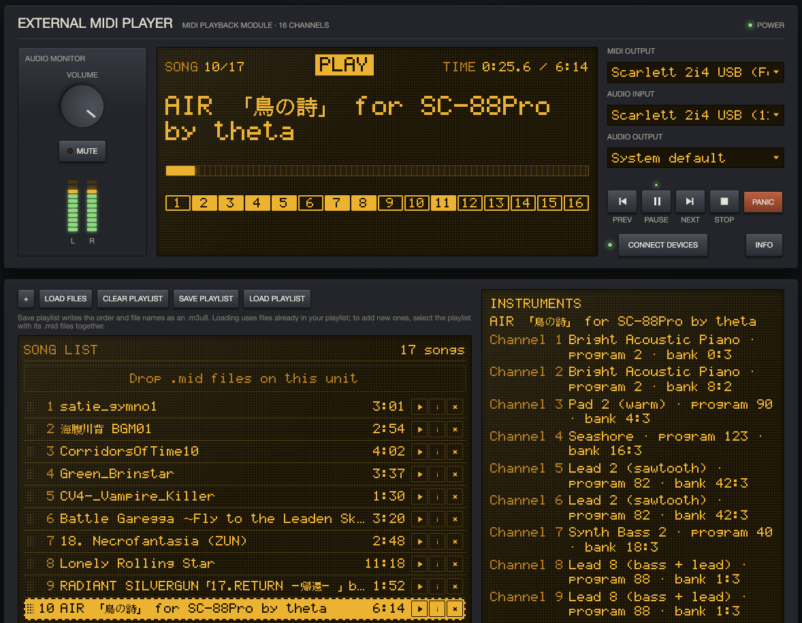

# External MIDI Player

Browser-based MIDI playlist player: plays `.mid` files out to external MIDI
hardware and monitors that hardware's audio back into the computer. Static
Vite + TypeScript app, no backend.



- Design (source of truth):
  [`Browser MIDI Playlist Player — MVP Design.md`](docs/Browser%20MIDI%20Playlist%20Player%20%E2%80%94%20MVP%20Design.md)
- Milestones: [`tasks/`](tasks/README.md) — T1–T20 are complete.

## Quickstart

```bash
npm install
npm run dev        # http://localhost:5173
```

Use `localhost` (or HTTPS) — Web MIDI and `getUserMedia` require a secure
context. Open the page in a desktop Chrome/Edge or Firefox and click
**Connect devices**.

## Tests

```bash
npx vitest run          # unit tests (device logic)
npx playwright test     # e2e, Chromium + Firefox (mocked Web MIDI / getUserMedia)
npx tsc --noEmit        # typecheck
```

CI runs the same three commands on every push and pull request — see
[Deployment](#deployment).

## Deployment

Live site: <https://wilsontr.github.io/external-midi-player/> — a static build
on GitHub Pages over HTTPS, which is required for Web MIDI and
`getUserMedia` (secure context).

`.github/workflows/deploy.yml` runs on every push to `main`, on pull requests,
and on `workflow_dispatch`:

1. **verify** (Ubuntu) — `npm ci`, `npx tsc --noEmit`, `npx vitest run`, then
   `npx playwright install --with-deps chromium` and
   `npx playwright test --project=chromium`.
2. **verify-firefox** (macOS) — `npx playwright install firefox` and
   `npx playwright test --project=firefox`. Firefox headless on the Linux
   runner drops synthetic pointer events (the Connect key receives no click),
   while the same suite passes on macOS Firefox, so the Firefox leg runs there.
3. **build** — `npm ci` and `npm run build`, then upload `dist` with
   `actions/upload-pages-artifact` (only outside pull requests).
4. **deploy** — `actions/deploy-pages` in the `github-pages` environment with
   `pages: write` and `id-token: write` (only on `main`, never for pull
   requests; the `pages` concurrency group serialises deployments without
   queueing PR checks behind them).

A failing test stops the pipeline before `build`, so nothing is uploaded and
the previous site stays live. Forks cannot deploy: the artifact upload and the
deploy job are both skipped for pull requests.

### One-time repository setup

1. **Settings → Pages → Build and deployment → Source: GitHub Actions.**
2. Optionally confirm **Settings → Environments → `github-pages`** exists (the
   workflow creates it on the first deploy) and add a required reviewer or a
   branch rule.
3. Confirm **Enforce HTTPS** is on once Pages has issued the certificate.

No repository secrets are needed: the workflow uses the default `GITHUB_TOKEN`
and OIDC.

### Redeploy and rollback

- **Redeploy without a new commit:** Actions → *Deploy to GitHub Pages* →
  **Run workflow** on `main` (`workflow_dispatch`).
- **Rollback:** re-run the last successful workflow run — it rebuilds and
  deploys that commit from scratch (artifacts are kept for 90 days) — or revert
  the bad commit and push, and let the workflow redeploy `main`.
- Every deploy to the same site replaces the whole `dist` tree; there is no
  partial update.

### Build output

`npm run build` writes `dist/` with **relative** asset URLs (`./assets/…` in
`index.html`, `../fonts/…` from the stylesheet), because `vite.config.ts` sets
`base: './'`. The same build therefore works at
`https://<owner>.github.io/<repo>/`, at a user page, and on a custom domain —
GitHub Pages' redirect from `/repo` to `/repo/` keeps the relative URLs
correct. `npm run dev` and Playwright are unchanged: they still serve from the
origin root.

### Storage is per origin

Playlist bytes, the current entry, device names, mute and volume are in
`localStorage`, which is scoped to the origin. The Pages origin starts with an
empty playlist and no remembered devices even if you have been using
`localhost`; connect devices again there. Clearing the playlist on the Pages
origin stays cleared, exactly as locally.

## Structure

| File | Responsibility |
| --- | --- |
| `src/midiDevices.ts` | Web MIDI access, output listing, hot-plug, remembering the selected output by name |
| `src/parser.ts` | Parse `.mid` files into flat, time-sorted event lists (tempo map, channels preserved) |
| `src/scheduler.ts` | Look-ahead scheduler with future-timestamped `MIDIOutput.send()`, note tracking and Panic |
| `src/synthOutput.ts` | Built-in SpessaSynth output: the bundled GeneralUser GS bank, and a `MIDIOutput` that renders the scheduler's timestamped messages at audio time |
| `src/playlist.ts` | Playlist entries, load/clear, transport state, background duration parse, auto-advance, seek forwarding, Panic-before-track-switch |
| `src/audioMonitor.ts` | Audio input capture, gain/mute, stereo level meter with an accessible dBFS description, output routing, latency |
| `src/ui.ts` | Half-rack faceplate markup (two units), knob/LED/part-strip wiring, Connect devices flow (MIDI + mic prompts), seekable timeline, single aria-live status region |
| `src/styles.css` | Faceplate skin: `:root` design tokens, chassis and LCD textures, responsive rack layout |
| `src/main.ts` | Entry point |
| `public/fonts/` | Self-hosted Graph 35+ pix LCD font (CC BY-SA 3.0) with its licence and attribution |
| `src/assets/` | Bundled assets fetched at runtime: the first-run sample song (CC BY-NC-SA 4.0) and the built-in synth's GeneralUser GS SoundFont |
| `legacy/t11-pre-faceplate/` | Pre-T11 UI files, kept for a possible swap back |

## Behaviour notes

- **Startup mute policy (T8, intentional):** a fresh profile starts with
  monitoring muted (R10 feedback safety); later visits restore the saved
  mute/volume instead of forcing mute.
- **Track metadata (T20):** the song list, LCD title, Instruments caption,
  row-key names and the M3U `#EXTINF` title use the file's `Track Name` when it
  has a usable one (trimmed, non-empty, not `untitled`); otherwise they keep
  the file name without its extension. Only the first track's (`Track 1` in
  the viewer) name may name the song; if it has no usable `Track Name`, every
  later track is ignored and the file name is used. The main LCD title is
  clamped to two lines with an ellipsis, so a long title cannot push the seek
  bar down. The `Track Name`, `Text Event` and `Copyright Notice` values are
  decoded per value as UTF-8, ISO-2022-JP, Shift_JIS, EUC-JP or Windows-1252,
  so Stanford-style Text Events and Japanese titles read correctly. Every healthy
  row's info key opens an amber LCD dialog listing all three fields with their
  track numbers; Close, Esc or a backdrop click dismisses it and returns focus
  to the key. While it is open the transport shortcuts — including Esc = Panic
  — are suspended. Metadata is persisted with the playlist and old stored rows
  are reparsed for it in the background; the original file name stays the M3U
  path and storage identity.
- **Instruments card (T16):** the card lists the channels the playing file
  uses and shows the program in effect at the current playback position, so a
  mid-song program change updates its row; pausing or seeking shows the
  program at that position. The channels themselves are listed from the start.
- **Playlist selection (T15, T18):** a single click selects a row and a
  double click (or the row's Play key) plays it from the start. Selection is
  a dotted outline, playing is the inverted highlight, and a row that is both
  shows both. While stopped the selection is the song Play will start; while
  playing or paused a single click moves only the selection, never what is
  sounding.
- **Seeking (T8):** the timeline is live while playing or paused and commits on
  release. While playing, sounding notes are released and the MIDI state at the
  target (program/bank, controllers, pitch bend, channel pressure) is re-sent
  after the look-ahead tail before playback continues from the target. A
  stopped song always restarts from 0, so seeking is disabled while stopped.
- **Track switches (T8):** switching to a different entry while playing or
  paused sends the full Panic (CC123/120/121 and CC64 = 0 on all 16 channels)
  after the old queue's tail, and the new track starts after the panic.
- **Volume knob (T19):** the monitor knob is a relative vertical drag — up
  increases, down decreases, measured from the value at the press, so pressing
  the knob never jumps the level to the pointer. About 120 px covers the whole
  0–100 range, the value clamps at both ends, and Shift trims at a quarter
  speed for fine setting. Dragging outside the knob keeps tracking (pointer
  capture) and no longer selects text or scrolls the page. The
  `#monitor-volume` range input remains the control and the single source of
  truth: clicking the knob focuses it, the arrow/Home/End keys and the focus
  ring still work, and only its native pointer behaviour is replaced.
- **First run (T12):** a browser profile whose playlist store has never been
  written starts with the bundled `Debussy - Poissons d'or` as the current,
  stopped entry, so Play works before any files are chosen. It arrives through
  the ordinary add/persist path (numbering, duration, reorder/remove, M3U
  export and reload all behave normally) and never autoplays. The first stored
  write makes the store authoritative, so Clear playlist — or removing the row
  — survives a reload instead of resurrecting the sample; files added while it
  is still downloading win, and a missing asset reports one status line and
  leaves the player empty but usable.
- **Built-in synth (T7):** the MIDI output picker also offers **Built-in
  synth**, which plays through SpessaSynth inside the page and needs no
  hardware or permission — it is selectable before Connect devices is pressed.
  Picking it loads the engine and the bundled GeneralUser GS SoundFont (about
  8.4 MB, fetched once) and only then selects it, so Play can never start
  against a half-loaded instrument; the status line reports loading and
  failure. It is an ordinary output otherwise: the same scheduler, pause, stop,
  next/previous, seek and Panic, and only one output (synth or hardware) is
  selected at a time: Connect devices reselecting your remembered hardware
  hands playback back to it, so the picker always shows what is playing. The
  bank is not remembered across reloads.
- **Song start (T13, T14):** a fresh start sends the file's tick-0 setup
  (program and bank changes, controllers, pitch bend, channel pressure)
  before the clock starts, spread across a 250 ms start lead but never faster
  than one message per 1.25 ms, with the last 100 ms of the lead left clear.
  That keeps a front-loaded multi-part setup from crowding the first chord
  off a serial MIDI line, and gives an older module time to load the patches
  the program changes selected before the first note. The song's clock starts
  at the end of the lead, which moves the first note from ~100 ms to ~350 ms
  after Play for a file with tick-0 setup; files without one keep the 100 ms
  lead, and tick-0 notes are not spread.

## Browser support

Current and previous desktop releases of Chrome/Edge and Firefox. Browsers
without `navigator.requestMIDIAccess` show an unsupported-browser notice.
Firefox users are shown the site-permission (add-on) explanation before the
first connect.

## Third-party assets

Code is MIT (see [`LICENSE`](LICENSE)).

`public/fonts/graph-35-pix.ttf` and `public/fonts/graph-35-pix.woff2` are
**Graph 35+ pix** by 30100flo (Florian Contreras), licensed under
[CC BY-SA 3.0](https://creativecommons.org/licenses/by-sa/3.0/). The WOFF2 is
a format conversion of the original TTF. Both files, their unchanged
`license.txt` and the archive's `readme.txt` ship together in `public/fonts/`;
see [`public/fonts/README.md`](public/fonts/README.md) for the full attribution.
The licence covers the font files only, not the application code.

`src/assets/debussy-poissons-dor.mid` is the first-run sample (T12):
*Poissons d'or* by Claude Debussy (1862–1918, public domain), as a MIDI
rendition extracted from the **Welte-Mignon T-100 "red Welte"** piano roll by
the [Stanford University Piano Roll Archive](https://supra.stanford.edu/)
(SUPRA), roll `jh696my0069`. The file keeps its own provenance text events
(`@ROLL_TYPE: welte-red`, `@DRUID: jh696my0069`). SUPRA licenses its extracted
MIDI files **CC BY-NC-SA 4.0**, which is not compatible with the repository's
MIT claim: the MIT licence covers the application code only, and this asset is
included unmodified under its own licence. It ships as a 30,352-byte SMF
(format 1, 570 PPQ, 3 tracks, 3:19) and is then stored in `localStorage` like
any other playlist row.

`src/assets/GeneralUserGS.sf3` is **GeneralUser GS 2.0.3 BETA** by S. Christian
Collins, licensed under the author's
[GeneralUser GS Licence v2.0](https://github.com/mrbumpy409/GeneralUser-GS/blob/main/documentation/LICENSE.txt)
(free to use and modify in software projects; redistribution of a local copy
with attribution is permitted — the same licence text is embedded in the
bank's `ICMT` chunk). It is the SF3 (Vorbis-compressed) build published with
SpessaSynth's demo, 8,423,728 bytes, `sha256 e2ed326f…97bc66c`. The author's
licence notes that the provenance of some samples is not fully documented; it
covers the SoundFont asset only, not the application code.

The built-in synth engine is [`spessasynth_lib`](https://github.com/spessasus/spessasynth_lib)
4.4.8 and `spessasynth_core` 4.4.10 (both Apache-2.0, with `fflate` MIT and
`stb-vorbis` Apache-2.0), loaded only when the built-in synth is selected.
The production CSP allows `'wasm-unsafe-eval'` for its SF3 decoder; it does not
allow JavaScript `eval`.

## UI skin notes (T11)

- The faceplate is a single committed dark theme. Every colour is a `:root`
  token in `src/styles.css`; there are no image assets. If a light skin is
  wanted later, swap the token block.
- The volume knob's rotation is pure CSS, driven by `--turn` from the range
  input. The input stays the accessible control but is pointer-inert (T19), so
  `.knob-wrap` handles the drag gesture in `ui.ts` instead.
- The LCD font is served from `public/` (same-origin), so the production CSP
  allows it; `font-src 'self'` is declared explicitly in `vite.config.ts`.
- `legacy/t11-pre-faceplate/` holds the pre-T11 `ui.ts` and `styles.css` for a
  possible swap back; nothing imports them.
